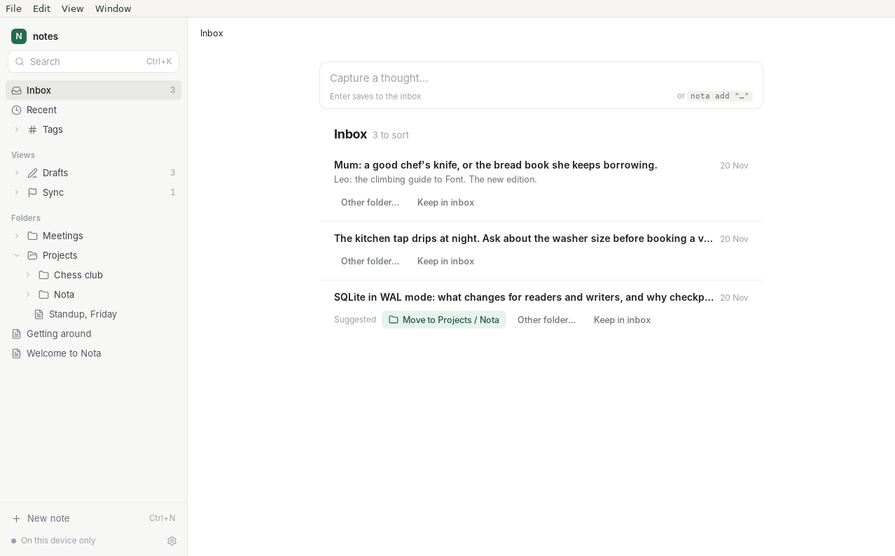
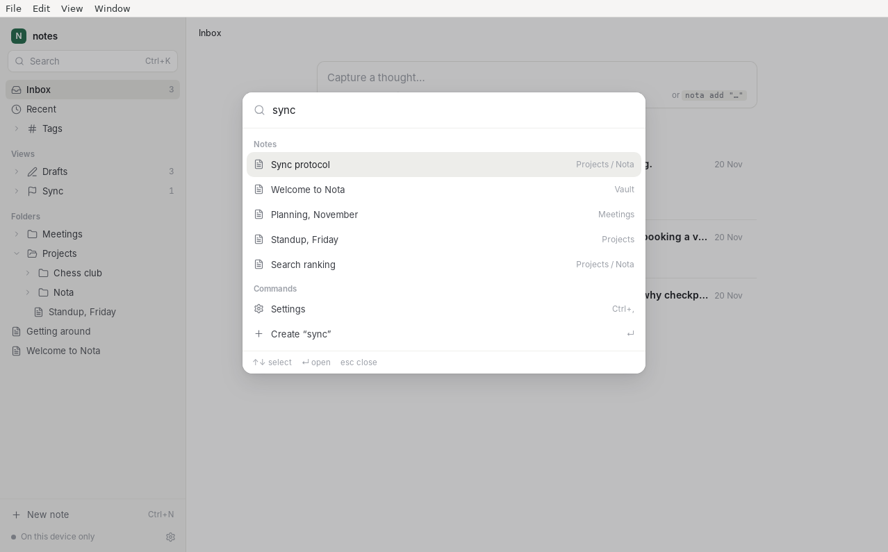
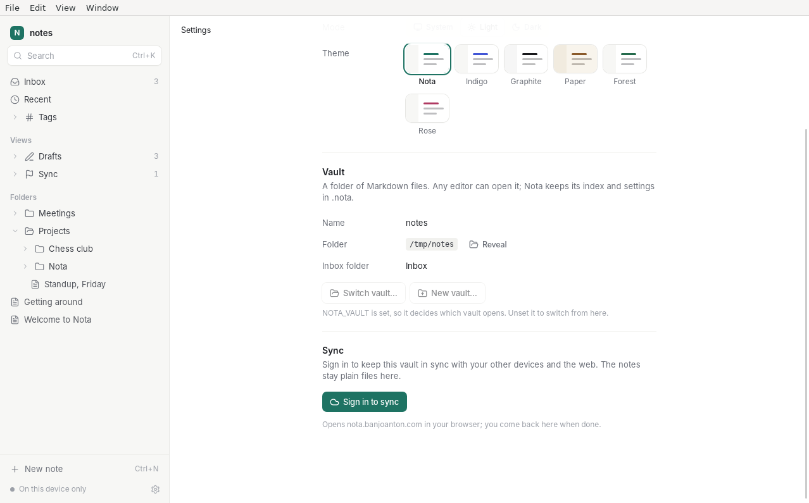

# Nota

Lightweight local-first markdown notes: CLI first, MCP, sync, desktop and phone app.

The plan is in [issue #1](https://github.com/banjo/nota/issues/1).

## Use the CLI

```sh
go install ./cmd/nota
nota add "Köp mjölk" --tag handla        # new note in Inbox/
echo "# Plan" | nota add --folder Projekt -
nota ls --tag projekt --where status=draft --sort "updated desc"
nota search "möte anna"
nota cat Plan                            # by path, title or unique prefix
nota set Plan status=done priority=2     # frontmatter, edited line by line
nota tag Plan +nota -draft
nota mv Plan Arkiv
nota inbox
nota ls --view drafts                    # .nota/views/drafts.yaml
nota index --rebuild
nota completion zsh > "${fpath[1]}/_nota"
```

Every command takes `--json` (errors then go to stderr as JSON too) and
`--verbose`. Exit codes: 0 ok, 1 error, 2 usage, 3 not found, 4 ambiguous
note reference, 5 target exists or differs only in case.

The vault is `--vault`, else `$NOTA_VAULT`, else `vault = "…"` in
`~/.config/nota/config.toml`, else `~/Notes`. The config also takes
`inbox = "Inbox"`. `.notaignore` (gitignore syntax) excludes files;
`.git/ .obsidian/ .nota/ .trash/ .DS_Store` are always ignored. The index
lives in `<vault>/.nota/index.db` and can be deleted at any time.

## Use it from an agent (MCP)

`nota mcp` is a Model Context Protocol server on stdio. Add it to Claude
Code, Hermes or any MCP client:

```json
{
  "mcpServers": {
    "nota": { "command": "nota", "args": ["mcp"] }
  }
}
```

In Hermes (`~/.hermes/config.yaml`):

```yaml
mcp_servers:
  nota:
    command: nota
    args: [mcp]
```

With Claude Code: `claude mcp add nota -- nota mcp`. Add `"--vault",
"/path/to/vault"` to the args to pick a vault other than the default.

Tools: `search_notes`, `read_note`, `list_notes` (folder, tag, `where`,
view), `create_note` (inbox by default), `append_to_note`, `update_note`
(pass `expected_hash` from `read_note` to avoid overwriting newer edits),
`update_frontmatter`, `move_note`, `list_tags`, `list_views`,
`get_backlinks`. Results are structured JSON; failures come back as tool
errors. Each note is also a resource at `nota://note/<path>` (percent-encode
non-ASCII names, e.g. `nota://note/M%C3%B6ten/Plan.md`).

The sync server offers the same tools over HTTP at `/mcp` (Streamable
HTTP, stateless), on the server's copy of a synced vault. Authenticate
with a device token; pick the vault with `?vault=name` or the
`Nota-Vault` header (default: your first vault). Writes become versions
of that token's device and sync to every machine:

```sh
claude mcp add --transport http nota https://nota.app.banjoanton.com/mcp \
  --header "Authorization: Bearer $NOTA_TOKEN"
```

## Hooks

Scripts in `.nota/hooks.toml` run when notes change, like git hooks. They
get the event as JSON on stdin (`event`, `vault`, `path`, `title`, `tags`,
`frontmatter`, `body`) and `$NOTA_VAULT`, `$NOTA_EVENT`, `$NOTA_NOTE`,
`$NOTA_HOOK`, and run with the vault as working directory (`sh -c`).

```toml
# File #jobb notes from the inbox into Jobb/ and tag them.
[[hook]]
name = "sort"
event = "inbox.added" # note.created note.saved note.moved note.deleted inbox.added sync.completed
mode = "transform" # "after" (default): async, never blocks
run = "sh scripts/sort.sh"
timeout = "2s" # default 2s for transform, 30s for after
match = { folder = "Inbox", tag = "jobb" }

# Log every save.
[[hook]]
event = "note.saved"
run = "cat >> .nota/saved.jsonl; echo >> .nota/saved.jsonl"
```

`scripts/sort.sh` prints a patch; empty output means no change:

```sh
#!/bin/sh
echo '{"folder": "Jobb", "tags": {"add": ["sorterad"]}, "set": {"status": "todo"}}'
```

Transform hooks run only on `note.created` and `inbox.added`. Their patch
(`set`, `unset`, `tags.add`/`tags.remove`, `folder`) goes through the
normal write path, so events fire and `updated` is set, but a hook's own
change never triggers it again. A hook that fails, times out or prints
something that is not a patch is logged and leaves the note unchanged.
`nota hooks list` shows the hooks; `nota hooks test inbox.added Inbox/x`
runs them on a note without applying anything. Hooks run in the CLI,
`nota mcp` and the desktop app.

## Sync

Sync is opt-in: a vault works offline forever without it. `nota serve`
is the sync server; every machine runs `nota sync` against it. The files
stay the truth: edits to different lines of a note on two machines
merge, edits to the same lines keep both (yours in
`Note (conflict 2026-11-22 1042 laptop).md`), deletes go to `.trash/`
and an edit always beats a delete. The protocol is in
[docs/sync-protocol.md](docs/sync-protocol.md).

Self-host the server (everything it keeps is in `--data`):

```sh
nota serve --addr :8080 --data /srv/nota          # or $NOTA_SERVER_ADDR, $NOTA_SERVER_DATA
nota serve --data /srv/nota user add you@example.com
nota serve --data /srv/nota token create you@example.com --device laptop   # prints the token once
nota serve --data /srv/nota token list            # and `token revoke <id>`
```

On each machine, with one token per device:

```sh
nota remote add https://notes.example.com --token nota_… --remote-vault main
nota sync            # one pass; --json for scripts
nota sync status     # unsynced changes, server cursor, daemon
nota sync --watch    # keep syncing: file changes, server nudges, every minute
```

`nota remote add` creates the server vault if it is new and keeps the
token in the OS keyring. Where there is none (a headless Linux box) it
says so and uses `~/.config/nota/credentials` (mode 0600) instead;
`NOTA_KEYRING=file` always uses the file and `NOTA_TOKEN` passes a token
without storing it. Sync state lives in `.nota/` (`sync.toml`,
`state.db`, merge bases); only one sync runs per vault at a time. The
desktop app syncs in the background when the vault has a remote. Hooks
on `sync.completed` run after every pass; transform hooks do not run on
notes that arrive through sync (they ran on the device that made them).
The shared configuration in `.nota/` (`hooks.toml`, `views/`, `plugins/`)
syncs like any file, so a hook added on one machine runs on the others
too; Nota's own state there stays local.

With an account (see [docs/api.md](docs/api.md)) a device signs in
without an admin: `nota login [url]` shows a code to approve in the web
app, `nota remote add <url>` then needs no `--token`, `nota devices`
lists the signed-in devices and `nota logout` revokes this one.

The server keeps every version: `nota history <note>` lists them (through
renames, `--version N` prints one) and `nota restore <note> <version>`
makes an old one the newest version and syncs it here.

The server keeps a working copy of each vault with an index in
`<data>/vaults/` (rebuilt from the version log when missing; `nota serve
rebuild` drops them). With `NOTA_SERVER_HOOKS=on` it runs each vault's
hooks on changes from clients, so a note captured on a phone is filed by
the server; their edits become versions of the device `server-hook` and
sync back everywhere. It is off by default because hooks are shell
commands from the synced vault, run with the server's permissions
(timeouts apply, nothing else is sandboxed).

## Notes and timestamps

Edits through Nota (`set`, `tag`, the app, MCP, hooks) set `updated` in the
frontmatter to the current local time, but only in notes that already have
frontmatter; `created` is written once by `nota add`/`create_note`. `mv`
does not touch the file. `nota tag -x` edits the frontmatter only: inline
`#x` in the body stays.

## Layout

- `cmd/nota`: the CLI entry point (also `nota mcp`, `nota serve`)
- `internal/vault`: files (on an `FS`: `DirFS` or the in-memory `MemFS`), note model, discovery, ignore rules, NFC paths
- `internal/edit`: note edits shared by the CLI, MCP, hooks and the app
- `internal/frontmatter`: byte-stable frontmatter edits
- `internal/markdown`: tags and links from note bodies
- `internal/index`: SQLite index (FTS, tags, properties, links)
- `internal/views`: saved queries in `.nota/views/*.yaml`
- `internal/events`: core event bus
- `internal/mcp`: MCP tools and resources (transport-agnostic)
- `internal/hooks`: `.nota/hooks.toml` scripts
- `internal/protocol`: sync protocol types (shared by server and client)
- `internal/server`: the sync server (SQLite version log, blobs, device tokens)
- `internal/sync`: the client sync engine (state, 3-way merge, conflict copies, watch)
- `internal/cli`: the commands
- `apps/desktop`: the MyGo app (Go + React)
- `packages/editor`: CodeMirror 6 setup
- `prototypes/`: UI prototypes

## Develop

Needs Go 1.27+ and Bun.

```sh
bun install
bun run dev          # desktop app (mygo dev + Vite+)
bunx vp check        # format, lint, types
bunx vp run -r test  # JS tests
go test ./...        # Go tests, incl. the 10k-note performance budget
go test -short ./... # without the 10k-note fixture
go test ./cmd/nota   # CLI scripts in cmd/nota/testdata/script
```

## Screenshots

The desktop app (macOS/Linux, MyGo + React), from `scripts/demo-vault.sh`:

| | |
| --- | --- |
|  |  |
| Tree, properties and live preview | Inbox triage with one-click filing |
|  |  |
| Command palette (⌘K) | Settings and sync sign-in |

Narrow windows switch to a navigation stack (`docs/screenshots/narrow.png`), and ⌃⌥N opens quick capture (`docs/screenshots/capture.png`).
