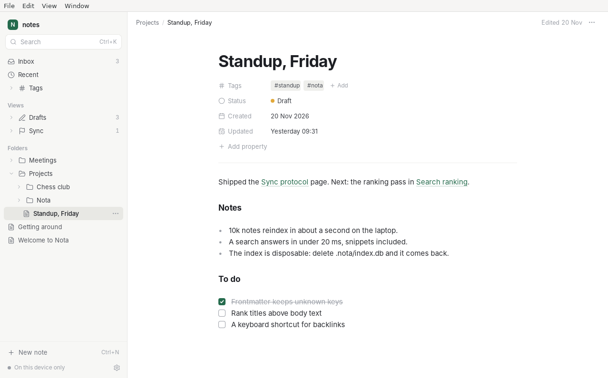

<h1 align="center">
  <picture>
    <source media="(prefers-color-scheme: dark)" srcset="assets/brand/lockup-dark.svg" />
    
  </picture>
</h1>

<p align="center">
  Your notes are files. Local Markdown notes in a small Go app for desktop and web, synced through your own server.
</p>

<p align="center">
  <a href="https://nota.banjoanton.com"><b>Website</b></a> ·
  <a href="docs/cli.md"><b>CLI</b></a> ·
  <a href="docs/agents.md"><b>Agents</b></a> ·
  <a href="docs/deploy.md"><b>Self-hosting</b></a>
</p>

<p align="center"></p>
<p align="center"><i>The desktop app over a folder of <code>.md</code> files: tree, properties from the frontmatter, live preview.</i></p>

> [!NOTE]
> Nota is early software. The CLI, MCP server and sync server work today; the desktop app ships
> with the first release.

## Highlights

- 📄 Plain files: every note is a `.md` file with optional YAML frontmatter, kept byte for byte. Any editor and `git` work on the same folder.
- ⌨️ CLI first: everything exists as a command before it exists as a button, and every command takes `--json`.
- 🤖 Built for agents: `nota mcp` serves 16 MCP tools over stdio, and the sync server offers the same tools over HTTP.
- ⚡️ Light: one 20 MB binary for the CLI, MCP and server; a search over 10,000 notes takes about 18 ms.
- 🔄 Sync you host: three-way merge per file, conflict copies instead of lost edits, a version history for every note.
- 📖 Three views per note: Live preview while you write, a read-only Reading mode (⌘E) and the raw Source, all from the top bar or ⌘K.
- 📂 Open any Markdown file: Finder's **Open With ▸ Nota**, the Dock or `nota open --app file.md` shows it as a read-only preview, editable as a draft and saved to the vault only when you say so. Nota is never made the default `.md` app.
- 🔑 No passwords: accounts are an e-mail address and a passkey, only needed for sync.
- 🎨 Themes: Nota's own, classics like Dracula, Nord and Solarized, and your own as a small JSON file in the vault.
- 🧩 Extensible: saved views without code, and hooks that run your scripts when notes change.

## Install

> Until the first release is out, only `go install` below works.

**macOS (Apple silicon), with Homebrew.** Installs the app and the `nota` CLI:

```sh
brew install --cask banjo/tap/nota
```

**Downloads.** Every [release](https://github.com/banjo/nota/releases) has:

| File                                                      | What                                                                                  |
| --------------------------------------------------------- | ------------------------------------------------------------------------------------- |
| `Nota-<version>-arm64.dmg`, `Nota-<version>-arm64.zip`    | macOS app, Apple silicon; the CLI is inside at `Nota.app/Contents/Resources/bin/nota` |
| `Nota-<version>-x86_64.AppImage`                          | Linux app, any distribution (`chmod +x` and run)                                      |
| `nota_<version>_amd64.deb`, `nota-<version>-1.x86_64.rpm` | Linux app packages, installed in `/opt/nota`                                          |
| `Nota-<version>-linux-amd64.tar.gz`                       | Linux app archive; `sh install.sh` inside installs it to `~/.local`                   |
| `nota_<version>_<os>_<arch>.tar.gz`                       | the CLI alone, for macOS and Linux on amd64 and arm64                                 |
| `checksums.txt`                                           | SHA-256 of every file (`sha256sum -c checksums.txt --ignore-missing`)                 |

The Linux app uses the system's WebKitGTK: `sudo apt install libwebkit2gtk-4.1-0` on Debian
and Ubuntu (the .deb pulls it in), `webkit2gtk4.1` on Fedora.

**The CLI with Go** 1.27 or newer:

```sh
go install github.com/banjo/nota/cmd/nota@latest
```

> [!IMPORTANT]
> The macOS app is not notarized (it is signed ad hoc, without an Apple Developer ID), so
> Gatekeeper blocks the first launch of a downloaded copy. The Homebrew cask clears the
> quarantine flag for you. For the DMG or zip, either open **System Settings → Privacy &
> Security** and click **Open Anyway** after the first attempt, or run
> `xattr -dr com.apple.quarantine /Applications/Nota.app`.

The first launch of the app asks where to keep your notes: a new folder (you pick the name and
the location) or one you already have, which Nota opens without moving or rewriting anything.
It also asks for the inbox folder and offers to sign in to sync, both optional. The choice goes
into `~/.config/nota/config.toml`, so the `nota` CLI uses the same vault. Settings › Vault can
switch to another folder or make a new vault later
([screenshots](docs/screenshots.md#first-run)).

## Quick start

The CLI uses `~/Notes` unless you pass `--vault`, set `$NOTA_VAULT` or set `vault` in
`~/.config/nota/config.toml` (which the app's first-run setup writes for you).

```sh
nota add "Call the plumber" --tag home      # A new note in Inbox/.
nota ls --tag home --sort "updated desc"    # Filter by tag, folder or frontmatter.
nota search "plumber"                       # Full-text search with snippets.
nota set "Call the plumber" status=done     # Edit frontmatter, line by line.
nota mv "Call the plumber" Home             # File it into a folder.
```

The full command list, configuration and exit codes are in [docs/cli.md](docs/cli.md).

## Agents

`nota mcp` is a Model Context Protocol server on stdio. Add it to any MCP client:

```json
{
  "mcpServers": {
    "nota": { "command": "nota", "args": ["mcp"] }
  }
}
```

With Claude Code: `claude mcp add nota -- nota mcp`. The tools, resources and the HTTP
endpoint of the sync server are in [docs/agents.md](docs/agents.md).

To teach your agent how to use Nota (CLI or MCP, views, hooks, themes, sync), add the skill:

```sh
npx skills add banjo/nota
```

## Self-hosting

A vault needs no account and no server. For sync, run `nota serve`: one container with its
state in one directory, e-mail and passkey accounts, a web app and HTTP MCP.
[docs/deploy.md](docs/deploy.md) covers Docker, configuration and the first user, and
[docs/sync.md](docs/sync.md) covers `nota sync` on each machine.

## Views and hooks

- Views are saved queries in `.nota/views/*.yaml`, shown as virtual folders in the app and
  listed with `nota ls --view <id>`.
- Hooks in `.nota/hooks.toml` run your scripts when notes change, like git hooks. A transform
  hook can file or tag a new inbox note before it is written.

Both sync with the vault. Details and examples: [docs/hooks.md](docs/hooks.md).

## Documentation

- [CLI](docs/cli.md): commands, configuration, ignore rules, timestamps.
- [Agents](docs/agents.md): MCP over stdio and HTTP, the tools and resources.
- [Views and hooks](docs/hooks.md): saved queries and scripts on note events.
- [Themes](docs/themes.md): the built-in themes and how to make your own.
- [Settings](docs/settings.md): `settings.toml` for your dotfiles, and settings synced with your account.
- [Sync](docs/sync.md): remotes, conflicts, history and restore.
- [Self-hosting](docs/deploy.md): the server, its configuration and the static web app.
- [Web API](docs/api.md) and [sync protocol](docs/sync-protocol.md): for clients.
- [Screenshots](docs/screenshots.md): the app, the web app and themes.

## Development

You need Go 1.27+ and [Bun](https://bun.sh). See [CONTRIBUTING.md](CONTRIBUTING.md).

```sh
bun install
bun run dev              # Desktop app (MyGo + Vite+).
bunx vp check            # Format, lint and types.
bunx vp run -r test      # TypeScript tests.
go test ./...            # Go tests, incl. the CLI scripts and the 10k-note budget.
```

## License

[MIT](LICENSE)
