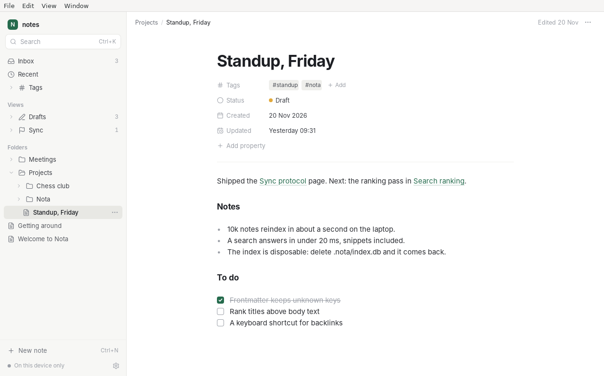
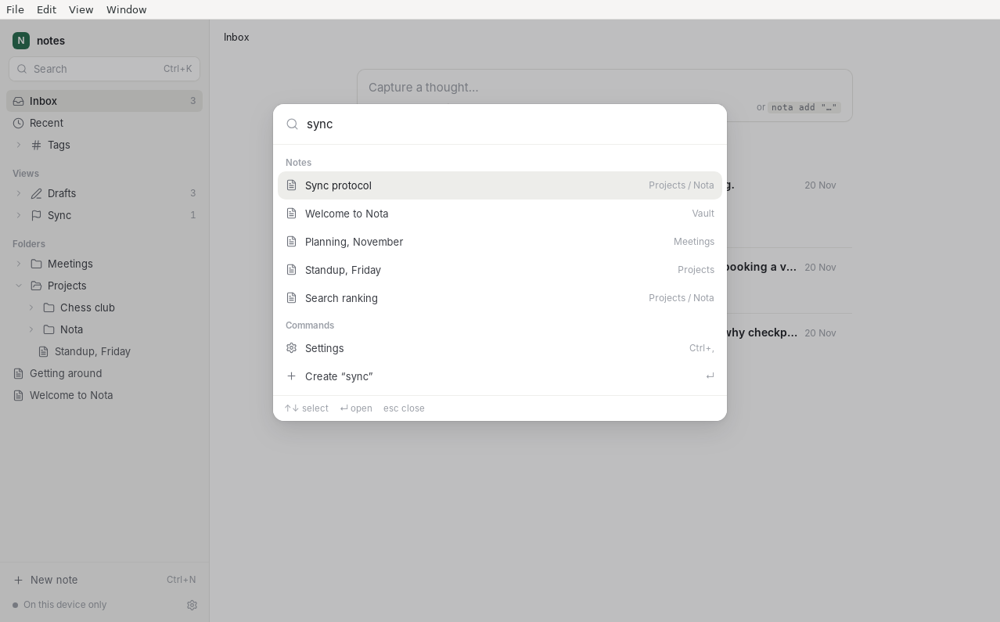
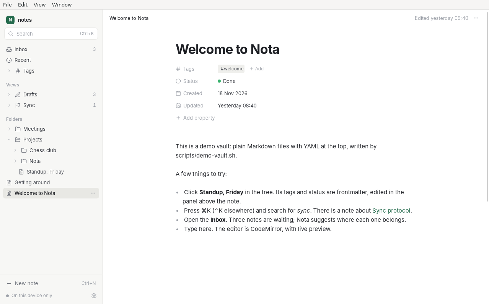
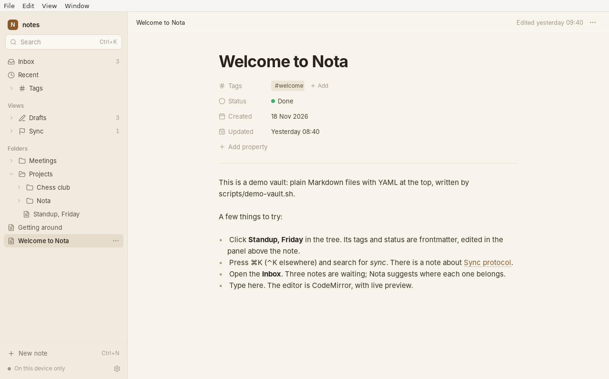

# Screenshots

The desktop app (MyGo + React) over the demo vault from `scripts/demo-vault.sh`:

| | |
| --- | --- |
|  |  |
| Tree, properties and live preview | Inbox triage with suggested folders |
|  |  |
| Command palette (⌘K) | Settings and sync sign-in |

Narrow windows switch to a navigation stack ([narrow.png](screenshots/narrow.png)), and ⌃⌥N
opens quick capture ([light](screenshots/capture.png), [dark](screenshots/capture-dark.png)).

## Themes

Settings › Appearance picks System, Light or Dark and one of six colour themes (Nota, Indigo,
Graphite, Paper, Jade, Rose); ⌘K has "Toggle dark mode" and "Theme: …". The choice is kept per
device, applied before the first paint, and followed by the quick-capture window and the desktop
window chrome. Every theme keeps body text at ≥ 4.5:1 and its ink at ≥ 3:1 in both modes
(`packages/app/tests/themes.test.ts`).

| | |
| --- | --- |
|  |  |
| Nota, light | Nota, dark |
|  |  |
| Settings › Appearance | Paper, for reading |

More: [Graphite dark](screenshots/theme-graphite-dark.png),
[Paper dark](screenshots/theme-paper-dark.png), [Indigo](screenshots/theme-indigo-light.png),
[Jade](screenshots/theme-jade-light.png), [Rose dark](screenshots/theme-rose-dark.png),
[Appearance in dark](screenshots/settings-appearance-dark.png) and
[theme commands in ⌘K](screenshots/palette-themes.png).

## Web app

The same UI over HTTP, against a vault on your own server: [sign in with a
passkey](screenshots/web-signin.png), [the app](screenshots/web-app.png) ([dark](screenshots/web-app-dark.png)),
[approving a sign-in](screenshots/connect.png), the [device list](screenshots/web-devices.png)
and the [recovery codes](screenshots/web-recovery-codes.png) shown once at sign-up (from a
throwaway local server).

## Landing page

