# Screenshots

The desktop app (MyGo + React) over the demo vault from `scripts/demo-vault.sh`:

| | |
| --- | --- |
|  | 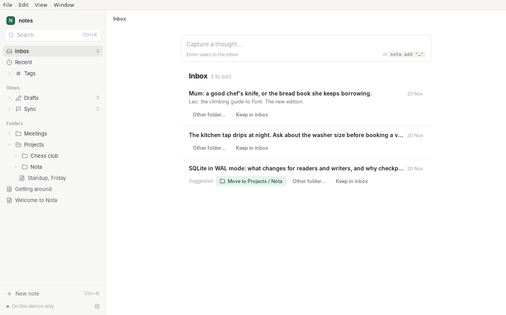 |
| Tree, properties and live preview | Inbox triage with suggested folders |
|  | 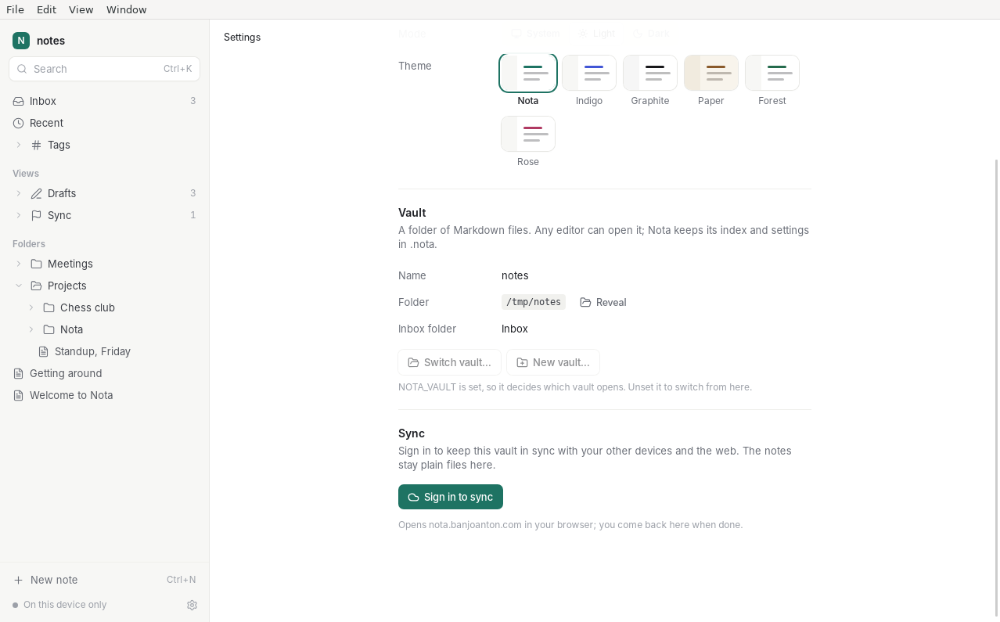 |
| Command palette (⌘K) | Settings and sync sign-in |

Narrow windows switch to a navigation stack ([narrow.png](screenshots/narrow.png)), and ⌃⌥N
opens quick capture ([light](screenshots/capture.png), [dark](screenshots/capture-dark.png)).

## First run

The first launch, with no vault chosen yet, walks through one decision per screen (↵ continues,
Esc goes back). Taken headless with a clean home folder.

| | | |
| --- | --- | --- |
| 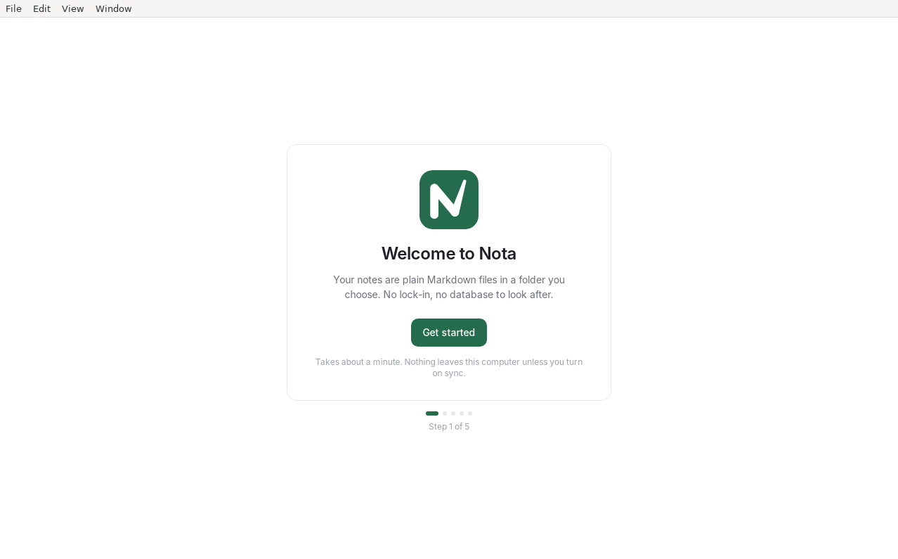 | 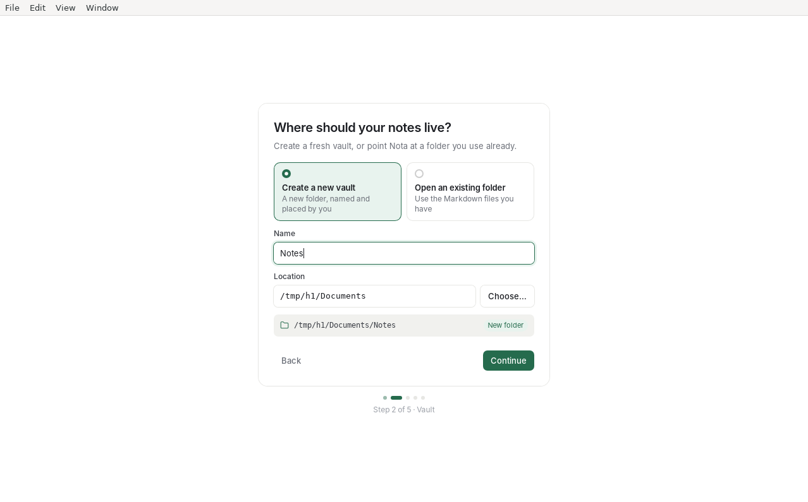 | 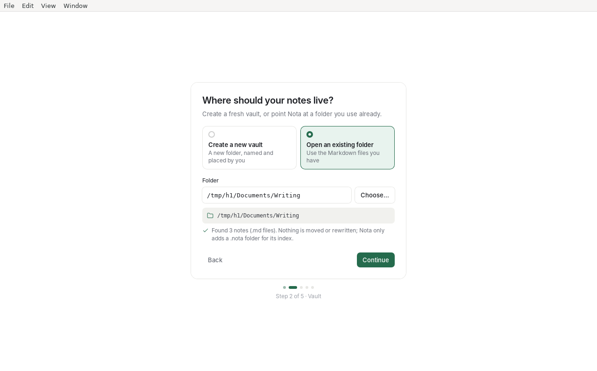 |
| Welcome | Create a vault: name, location, live path | Open an existing folder: notes found, nothing moved |
| 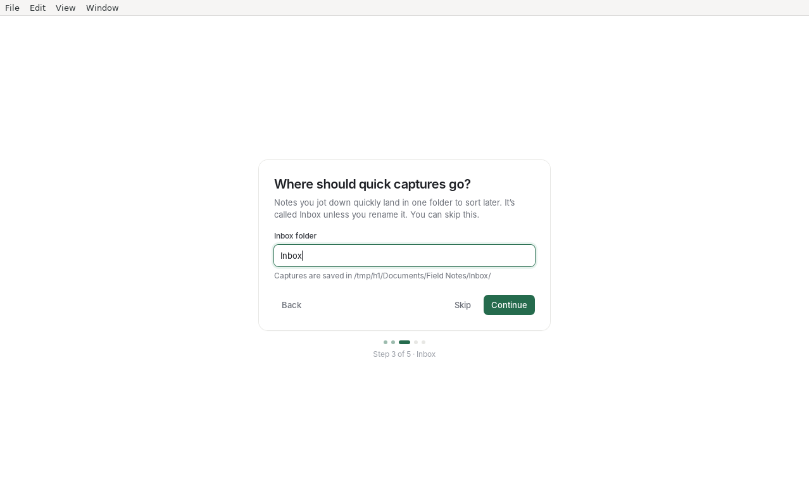 | 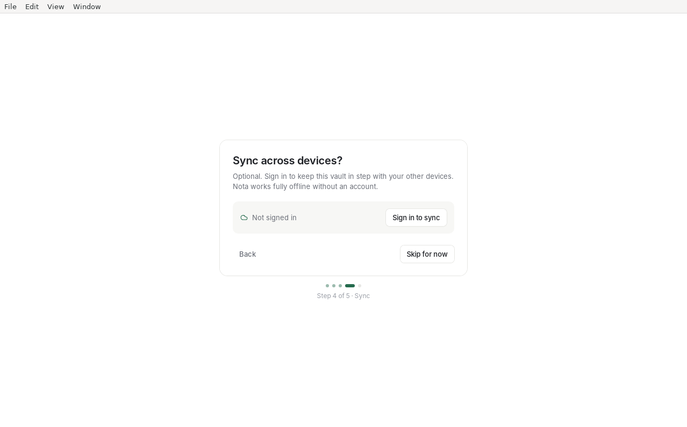 | 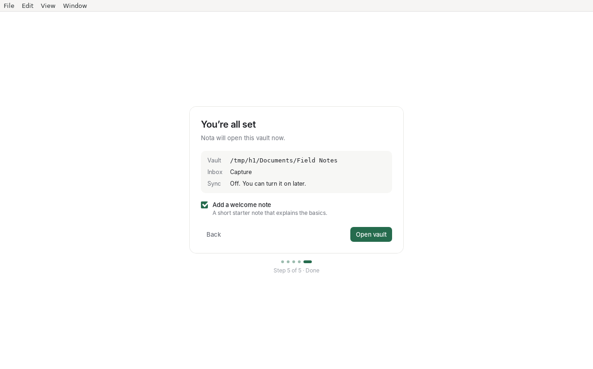 |
| Inbox folder, skippable | Sign in to sync, skippable | Done, with the welcome-note checkbox |

Errors show under the field: [a name with a slash](screenshots/onboarding-2b-badname.png), [a folder
that exists and isn't empty](screenshots/onboarding-2c-exists-nonempty.png) (with "Use existing
folder instead"), [a bad inbox name](screenshots/onboarding-3b-inbox-error.png) and
[waiting for the browser](screenshots/onboarding-4b-sync-waiting.png). "Choose…" opens the system's
[folder chooser](screenshots/onboarding-2f-folder-picker.png). Finishing writes the config and
Nota restarts into [the new vault](screenshots/onboarding-6-opened.png); the next launch
[goes straight in](screenshots/onboarding-7-restart-opens-vault.png).

[Settings › Vault](screenshots/onboarding-8-settings-vault.png) and ⌘K
([Switch vault…, New vault…](screenshots/onboarding-8b-palette-vault-commands.png)) run the same
screens over the app ([switching](screenshots/onboarding-9-switch-vault.png),
[done](screenshots/onboarding-9d-switch-done.png)), then [open the other vault](screenshots/onboarding-10-switched.png).

## Reading and source

Each note has three views, switched from the top bar or ⌘K ("View: Source mode"); ⌘E swaps Live and
Reading. The choice is kept per device and applies to every note you open next. Reading hides every
marker and blocks typing, but links, tags and checkboxes still work.

| | | |
| --- | --- | --- |
| 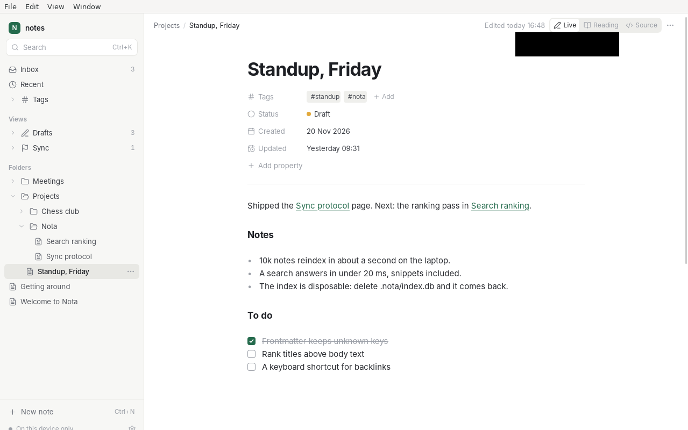 | 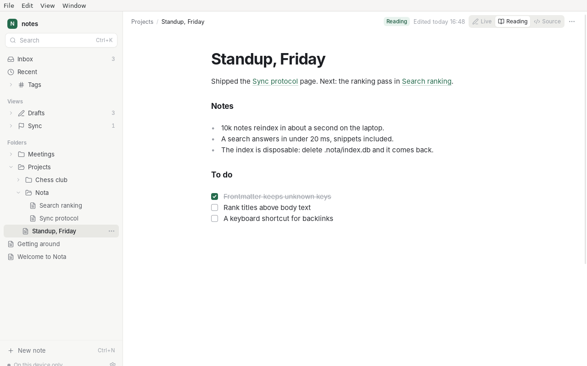 |  |
| Live: markers show on the line you edit | Reading: the finished page, read-only | Source: the raw markdown |

On a narrow window the switch shows icons only ([narrow](screenshots/mode-narrow.png)).

## Themes

Settings › Appearance picks System, Light or Dark and one of six colour themes (Nota, Indigo,
Graphite, Paper, Jade, Rose); ⌘K has "Toggle dark mode" and "Theme: …". The choice is kept per
device, applied before the first paint, and followed by the quick-capture window and the desktop
window chrome. Every theme keeps body text at ≥ 4.5:1 and its ink at ≥ 3:1 in both modes
(`packages/app/tests/themes.test.ts`).

| | |
| --- | --- |
|  | 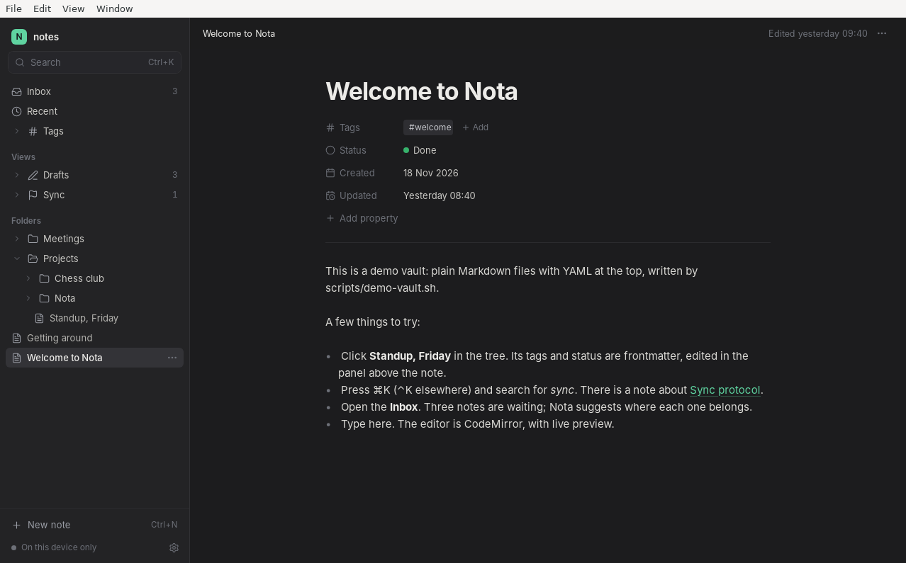 |
| Nota, light | Nota, dark |
| 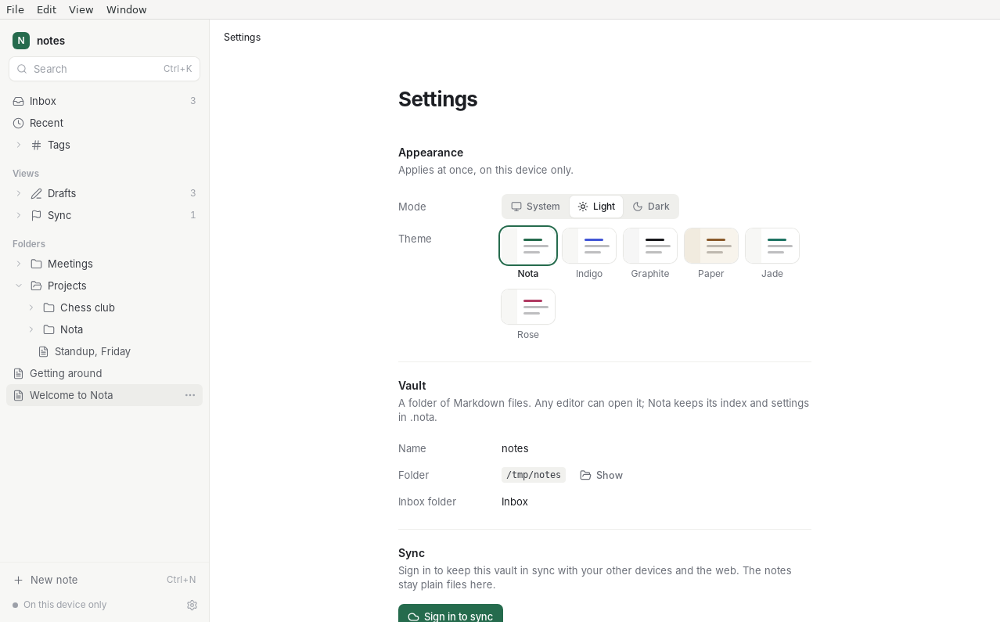 |  |
| Settings › Appearance | Paper, for reading |

More: [Graphite dark](screenshots/theme-graphite-dark.png),
[Paper dark](screenshots/theme-paper-dark.png), [Indigo](screenshots/theme-indigo-light.png),
[Jade](screenshots/theme-jade-light.png), [Rose dark](screenshots/theme-rose-dark.png),
[Appearance in dark](screenshots/settings-appearance-dark.png) and
[theme commands in ⌘K](screenshots/palette-themes.png).

## Web app

The same UI over HTTP, against a vault on your own server: [sign in with a
passkey](screenshots/web-signin.png), [the app](screenshots/web-app.png) ([dark](screenshots/web-app-dark.png)),
[approving a sign-in](screenshots/connect.png), the [device list](screenshots/web-devices.png)
and the [recovery codes](screenshots/web-recovery-codes.png) shown once at sign-up (from a
throwaway local server).

## Landing page

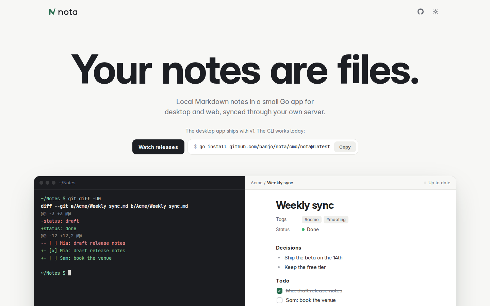
